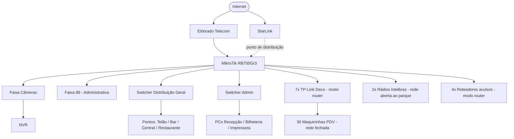

# Topologia da infraestrutura
> Última atualização:  | Responsável: Nivando Soares

## Visão geral

O fluxo da operação (NFC → pulseira → código de barras → entrada/saída/consumo) está descrito em [01b-fluxo-operacao.md](01b-fluxo-operacao.md).

- MikroTik RB750Gr3 central, com Eldorado Telecom como link principal e faixa 88 administrativa mantida enxuta de propósito.
- O antigo ponto StarLink distribui a rede do ISP atual; não é mais uma segunda saída de internet para failover.
- 7 TP-Link Deco e 4 roteadores avulsos de outra marca ficam em modo **router**, cada um com DHCP próprio.
- 2 rádios Intelbras de longo alcance atendem redes abertas do parque. As 30 maquininhas do ERP ficam em **redes fechadas**.
- Câmeras e NVR usam faixa dedicada; há 6 computadores via cabo, 2 via Wi-Fi, relógio de ponto com IP fixo terminado em `.200` e Raspberry Pi: .

###  Mudança importante: StarLink NÃO é mais failover

Após um ataque ao MultiClubes no RJ, a fornecedora fechou as rotas de entrada e passou a autorizar o acesso por white list de IP público. Nosso IP autorizado é o da Eldorado Telecom: .

Quando a saída mudava para StarLink, o IP público mudava e o ERP bloqueava o acesso. Por isso, o ponto onde ela entrava foi reaproveitado para distribuir a rede do ISP atual. Hoje não há plano B de link validado para o ERP; não tratar configurações antigas de backup como contingência disponível.

## Diagrama ASCII

**Referência histórica, preservada:** o ASCII abaixo mostra a situação anterior e ainda chama StarLink de backup. Para a operação atual, use a visão geral e o Mermaid; StarLink não é mais failover.

```text
[Eldorado Telecom — principal]     [StarLink — backup]
                 \                 /
                   [MikroTik RB750Gr3]
                            :
          [Distribuição e conexões a confirmar]
               :            :             :
     [Rede operacional] [Faixa de câmeras] [Redes de rádio secundárias]
      PDVs / PCs / APs     NVR / câmeras
      Raspberry Pi

[Acesso remoto: Tailscale (TailNet) / RDP de urgência]
[Cloud: MultiClubes / backup administrado pela fornecedora]
[Internos: catraca interna/servidor web / EzpointWeb]
[Externos: WordPress Admin / e-mail / StayCloud (domínio)]
```

Os trechos com `:` representam conexões a confirmar. As caixas finais listam serviços; não representam rotas ou localização física.

## Diagrama Mermaid — visão atual

Mantém os blocos do ASCII e incorpora a mudança da StarLink. As linhas pontilhadas indicam caminhos físicos ou associação dos PDVs ainda a confirmar; não significam ligação de PDV à rede aberta.



## Faixas de IP

| Rede ou equipamento | Faixa / endereço | Observação |
| --- | --- | --- |
| Administrativa — faixa 88 | `192.168.88.0/24`; MikroTik `192.168.88.1` | Endereços confirmados na coleta SSH de 08/10/2026 |
| Câmeras e NVR | `192.168.200.0/24`; MikroTik `192.168.200.1` | Confirmados na coleta;  |
| PDVs |  | Redes fechadas; 30 maquininhas |
| Rádios Intelbras |  | Redes abertas do parque |
| Deco e avulsos |  | DHCP próprio por equipamento |
| Relógio de ponto |  | Fixo; não confundir o final `.200` com a faixa das câmeras |

### DHCP

Na operação descrita, o MikroTik distribui endereços somente na faixa 88. Os Decos e avulsos estão em modo router com DHCP próprio para manter essa faixa enxuta e não concentrar as concessões no MikroTik. Não mudar o modo sem revisar o desenho da rede.

A coleta SSH anterior também encontrou um DHCP configurado para câmeras. .

### DNS

Na coleta, o MikroTik usava `8.8.8.8` e `8.8.4.4`, além de DNS recebido da Eldorado, e anunciava `192.168.88.1` para a faixa 88. .

### VPN / Acesso remoto

- Tailscale (TailNet): .
- UltraVNC: gerenciamento interno via IP; .
- RDP de urgência: .
- WireGuard encontrado na coleta anterior: veja [MikroTik](03-mikrotik.md); .

### Portas e serviços relevantes

| Serviço | Porta / referência | Onde e quem administra |
| --- | --- | --- |
| MikroTik SSH | TCP 22, confirmado na coleta | `192.168.88.1`;  |
| MikroTik Winbox | TCP 8291, habilitada na coleta | `192.168.88.1`;  |
| UltraVNC e RDP |  |  |
| MultiClubes / PDV / TEF |  | Saída pelo IP público Eldorado autorizado |
| NVR, catraca interna/servidor web e EzpointWeb |  |  |

## Dados para completar a topologia

| Item | Referência |
| --- | --- |
| Eldorado e antigo ponto StarLink |  |
| Distribuição |  |
| Rede operacional |  |
| Câmeras e NVR |  |
| Rádios secundários |  |
| Acesso remoto |  |
| Sistemas internos |  |

## 🧭 Notas do handover
