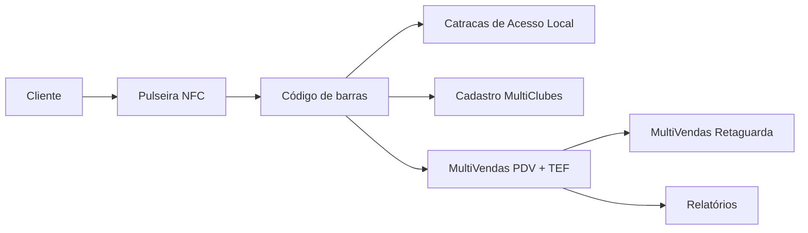

# 01b — Fluxo da Operação
> Última atualização:  | Responsável: Nivando Soares

## 1. Base da operação: NFC

A operação gira em torno de NFC. O fluxo é:

1. O cliente recebe uma **pulseira NFC**.
2. A pulseira guarda um **código de barras** associado a:
   - um **cliente** (sócio/visitante);
   - um **cartão de consumo**.
3. A partir desse código de barras:
   - **entrada e saída** do parque são vinculadas;
   - **consumo** (PDV, bar, restaurante, etc.) é vinculado;
   - tudo é **rastreável** e pode ser levantado por dia.

## 2. O que isso significa na prática

- Toda operação (entrada, saída, consumo) fica amarrada a um único identificador: o código de barras da pulseira.
- É possível levantar **todas as operações feitas no dia** por cliente.
- Se a pulseira não lê, a operação trava. 

## 3. Cadeia de sistemas

| Etapa | Sistema | Responsável |
| --- | --- | --- |
| Cadastro de sócio/cliente | MultiClubes | Fornecedora (cloud) |
| Emissão/ativação de pulseira | MultiClubes | Fornecedora (cloud) |
| Entrada/saída (catraca) | MultiClubes + Id Control | Fornecedora |
| Consumo no PDV | MultiVendas PDV + TEF | Fornecedora |
| Retaguarda financeira | MultiVendas Retaguarda | Fornecedora |
| Relógio de ponto | EzPoint Web |  |

## 4. Diagrama do fluxo (Mermaid)

